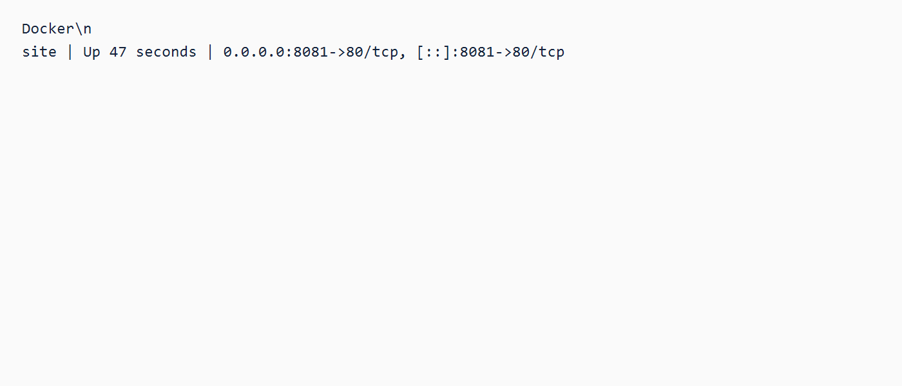
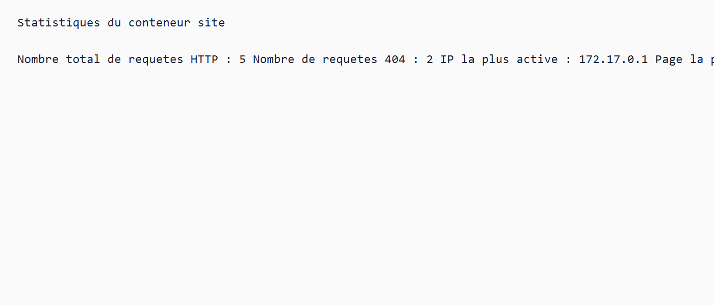

# site-equipe

Projet collaboratif Dockerise presentant les profils d'Islam Fahima et d'Akram Maali.

## Technologies

- HTML5 et CSS3
- PHP 8.4 avec Apache
- Docker
- GitHub Actions
- Scripts Bash Linux

## Roles

- **Islam Fahima (@Isl-fh)** : developpement du contenu du site, integration Docker et Git.
- **Akram Maali (@Akrammaali15)** : developpement front-end, validation visuelle et collaboration GitHub.

## Installation sur un serveur neuf

```bash
sudo apt update
sudo apt install -y git docker.io curl
sudo systemctl enable --now docker
sudo usermod -aG docker "$USER"
git clone https://github.com/LinuxECEOrga/site-equipe.git
cd site-equipe
git checkout main
./scripts/deploy.sh
```

Deconnectez-vous puis reconnectez-vous si Docker signale un probleme de permissions apres `usermod`.

## Utilisation locale

```bash
docker build -t site-equipe .
docker run -d --name site -p 8081:80 site-equipe
curl http://localhost:8081/
```

Le site est ensuite disponible sur <http://localhost:8081/>.

## Domaine local

Pour utiliser `http://site.local:8081/`, ajoutez cette ligne avec les droits administrateur :

```text
127.0.0.1 site.local
```

Sous Linux : ajoutez-la dans `/etc/hosts`. Sous Windows : ajoutez-la dans `C:\Windows\System32\drivers\etc\hosts`, puis ouvrez <http://site.local:8081/>.

## Scripts

### Deploiement

```bash
chmod +x scripts/deploy.sh scripts/stats.sh
./scripts/deploy.sh
```

Le script recupere `main`, reconstruit l'image `site-equipe`, remplace le conteneur `site` et verifie le port 8081.

### Statistiques

```bash
./scripts/stats.sh
./scripts/stats.sh site
```

Le premier argument permet de choisir le conteneur. Par defaut, le conteneur est `site`.
Les statistiques sont calculees avec `grep`, `cut`, `sort`, `uniq`, `head` et `awk`.

## Alias bonus

Ajoutez cet alias a `~/.bashrc` :

```bash
alias deployer='/chemin/vers/site-equipe/scripts/deploy.sh'
```

Puis rechargez la configuration :

```bash
source ~/.bashrc
deployer
```

## Captures

Ajoutez les trois captures dans ce README apres validation du projet :

### 1. Page du site


### 2. Conteneur Docker actif



### 3. Statistiques Apache



Les captures sont facultatives pour le build Docker, mais elles permettent de documenter le rendu final.